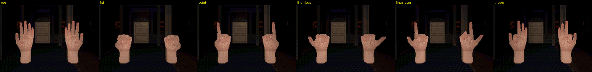
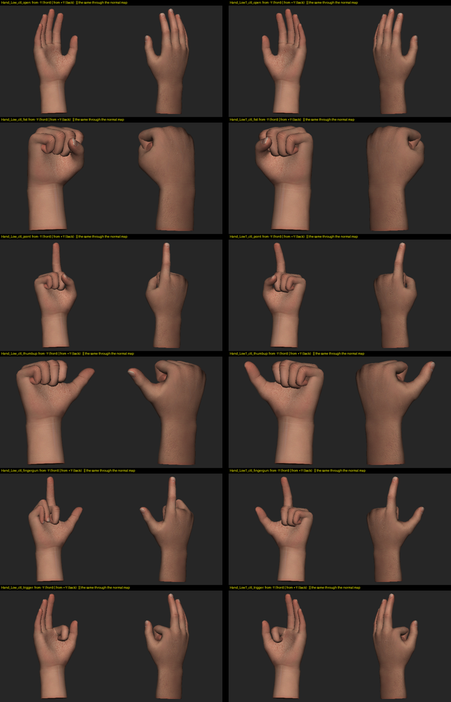

# VRealms

**Realms of the Haunting (1996), in VR.**

Not a port and not a remake. The engine opens your own retail installation and builds the
game from it at load — maps, artwork, 3D props, level logic. Nothing is extracted,
converted or cached, and nothing from the original ships with this. **You must own the
game.**

Underneath is a GZDoom fork with VR built into it rather than bolted on, so Realms
inherits room-scale tracking, real hands, and everything else already living there.

## Running it

```
doomxr.exe -iwad vrealms.pk3 -rothpath "<path to your ROTH folder>" +map STUDY1
```

The path must be quoted — it contains spaces. The IWAD is **`vrealms.pk3`**
specifically, not any IWAD: it supplies the palette, an episode and a skill,
without which the engine stops before the video backend is up and exits silently.

Every load writes a full report beside the executable: what was opened, what was in it,
and a counter for anything the loader did not understand. Nothing fails silently.

## Where it is

A level loads from the retail install with geometry, textures, animated and translucent
surfaces, 3D furniture, intermediate floors, and doors on their real hinges. You can walk
through it, open doors, and the original's level scripts run.

Section by section (rows A-G as of 2026-10-03; H and I updated 2026-11-13). Percentages are deliberately absent — each line
says what works and what is known to be missing instead, because that is checkable.

| | | |
|---|---|---|
| **A. Map loading** | **Done** | All 44 retail maps. Geometry, sectors, faces, the command tables. STUDY1 is 552 sectors, 1,908 lines, 2,754 sides, 242 objects |
| **B. Surfaces & texturing** | **Mostly** | Flats, walls, mid-platforms, the stored-extent scale law, colour-key surfaces left undrawn as the original does. Open: one wall at the start pose reading 19.6 against the original's 1.7, ceiling seams, trees drawing as green streaks |
| **C. Lighting** | **Mostly** | The original's shading model, the candle cone, the load-time lights-out pass (139 sectors, exact match). Open: the storm glow has never been seen on screen; palette shading on sprites |
| **D. Props & meshes** | **Mostly** | Placement verified to ~1 px, directional sprites settled, prop drift fixed. Open: mesh facing — some furniture needs a 90° turn, narrowed to the model's own forward axis |
| **E. Doors** | **Open by the use key** | Built on their real hinges, 30 of 30 in STUDY1, and the use key swings them. **Open: the leaf is built full-height so it drives through the masonry above the opening, and renders black when closed.** The largest visible fault in the game right now |
| **F. Level logic (triggers)** | **Done** | All four reachable channels verified firing: left-click wall, enter/leave sector, floor click, weapon impact. One sector's script warps the map, which is the original's own scripted transition running |
| **G. The command interpreter** | **Partly** | 209 of 441 instruction records in STUDY1 implemented, plus the active-effect pool and 14 of its 15 ticks. The remaining one slides a sector by moving its vertices, which GZDoom's static BSP cannot do |
| **H. The game layer** | **Partly** | DBASE100 read from the install. Inventory, menus, save/load, dialogue, subtitles, timed messages, HUD and the examine popup are drawn by the original's own routines (pixel diffs against the running original: 0 differ). Weapons fire. See the newest `HANDOFF_*.md` for what is open |
| **I. VR** | **Hands in, scale to judge** | The owner's FBX hands, read by the engine itself and posed from their own animation (below). The headset's metre now puts the player's eye where the original's camera is (144 units above the feet) with the original's vertical stretch (1.1462); not yet judged in the headset |

The honest summary: **you can walk around a Realms level and the game's own scripts
react to you.** What you cannot yet do is talk to anyone, pick anything up, or fight.

## VR hands

The hands are the owner's own `hand_final.fbx` (two separate hands, each with its own
skeleton and its own animation), read by the engine at load with
[ufbx](https://github.com/ufbx/ufbx) — no conversion to another format. The left hand
wears the right hand's skin through its mirrored texture layout; both carry the FBX's own
normal and roughness maps.

The controller's capacitive touches pick a pose and trigger and grip move the hand into it.
Every pose is an **authored frame of that hand's own animation** (or, where the animation
has no single frame for it, each finger taken whole from one authored frame, the owner's own
method), and every in-between is a mix of two authored frames. Smoothing is UZDXREMA's.

| index on trigger | thumb touching | pose |
|---|---|---|
| yes | yes | fist |
| yes | no | thumb up |
| no | yes | point |
| no | no | finger gun |

Trigger alone curls the index; nothing held is the open hand.

The buttons (the owner's scheme): the **trigger** is the original's primary click, **examine**, and the
**grip** its secondary, **use** -- on what the palm is on, or what the straight index points at, at the
original's range. On the inventory screen they are the original's two mouse buttons at the laser or the
fingertip. A hand holding a weapon fires on its trigger.

In the engine (flat test, `tools/claude_bridge/cfg/hands_flat.cfg`) — open, fist, point,
thumb up, finger gun, trigger only:



The same states up close, right and left (software render of the engine's pose math,
`tools/fbxload_test`):



How the frames were chosen: every frame of each hand's animation walked
(`tools/fbxload_test/walk_poses.py`), with the candidates side by side —
[right](docs/images/hands/walk_Hand_Low.png), [left](docs/images/hands/walk_Hand_Low1.png),
and four frames of the right hand (1 open, 144, 319 fist, 689) in
[take_frames_right.png](docs/images/hands/take_frames_right.png).
The loader and the poses are documented in `docs/FBX_LOADER.md`.

## Where it is going

- **Gestures** — reaching, grabbing, turning and opening, rather than pressing a button
  at a thing.
- **A VR-forward inventory.** The original's was a grid on a screen. In a headset it
  should be something you reach into.
- **Weapon handling** with real two-handed manipulation, holsters and hardpoints.
- **Enemies** faithful to the original first, then free to be smarter.
- **Props with weight** — furniture you can actually move, with mass behind it.
- **Modern visual effects** where they serve the atmosphere. Realms was always about
  darkness and what is in it.
- **Doom mods still work.** It is still the fork, so the wider ecosystem comes along.

## Reading the code

- `LANE_START.md` — **start here.** Which document holds what, which parts of each are
  out of date, and what to do in what order.
- `docs/REMAROTH_MEASURED.md` — everything checked against the running original, with
  numbers. When it and another document disagree, this one wins.
- `ROTH_STATE.md` — the loader's layout and the file formats. Parts of §5-§7 are
  superseded; `LANE_START.md` §2 says which.
- `ROTH_LIGHTING.md` — the original's lighting model, transcribed.
- `ROTH_COMMANDS.md` — its level-logic system, decoded.
- `ROTH_BETTER.md` — things the 1996 engine does better than the one hosting it.
- `README_ENGINE.md` — the host fork, and its lineage: GZDoom → Team Beef → emawind's
  QuestZDoom → iAmErmac's DoomXR → UZDXREMA.
- `wadsrc/static/zscript/fishy/` — third-party script code, unmodified:
  3D Platform by FishyClock, GPL-3.0, https://github.com/FishyClock/3Dplatform.
  The moving-sector platforms behind `roth_platforms` are built on it.

The rule throughout: **the original is the specification.** Where it and the host engine
disagree, the original wins and the engine changes to suit. Anything not read out of the
original's own code is marked unverified — guessing has cost more time here than reading
ever has.
