<p align="center">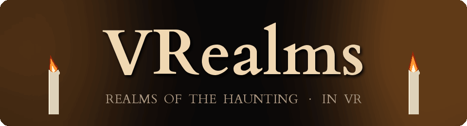</p>

<p align="center"><b>Realms of the Haunting (1996), reimagined for VR with full 6DoF, built from your own retail install.</b><br>
You are Adam, in the house, with your own two hands. Everything you can see, you can reach for.</p>

<p align="center">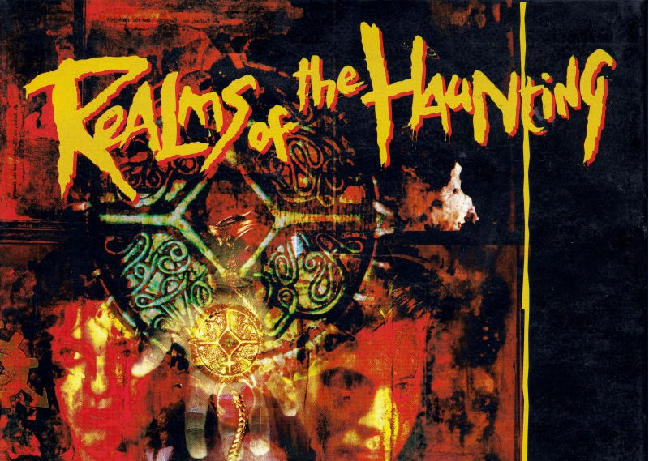</p>

<p align="center"></p>

## 

The engine opens your own copy of the game at load and builds it from there: the maps, the artwork, the 3D props, the level logic, the inventory, the menus and the dialogue. Nothing is extracted, converted or cached, and **nothing from the original ships with this. You must own the game.**

Underneath is a GZDoom fork with VR built into it, not bolted on: room-scale tracking, real hands and Jolt physics. Underneath that, the original game still runs. Its chains, pickups, keys, reach and damage numbers stay 1:1 with **ROTH.C**, the reconstructed original program, and they are proven by differential tests against it. VR changes how you do a thing, never what it does, unless the owner decides otherwise.

> The plan, milestone by milestone: [`docs/VR_GAME_PLAN.md`](docs/VR_GAME_PLAN.md). Coders: [`CLAUDE.md`](CLAUDE.md) first, then the newest `HANDOFF_*.md`.

<br>

## 

Gremlin Interactive's *Realms of the Haunting* came out for DOS in 1996: Adam Randall, a house in Cornwall, and what lives under it. Its rooms were built in full 3D, with full-motion video between them. Every picture below is the original, and the original is the spec.

<table>
<tr>
<td width="50%">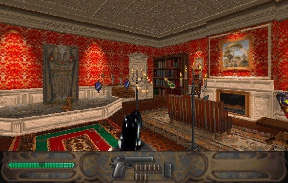<br><sub>The house, with the Colt in hand.</sub></td>
<td width="50%">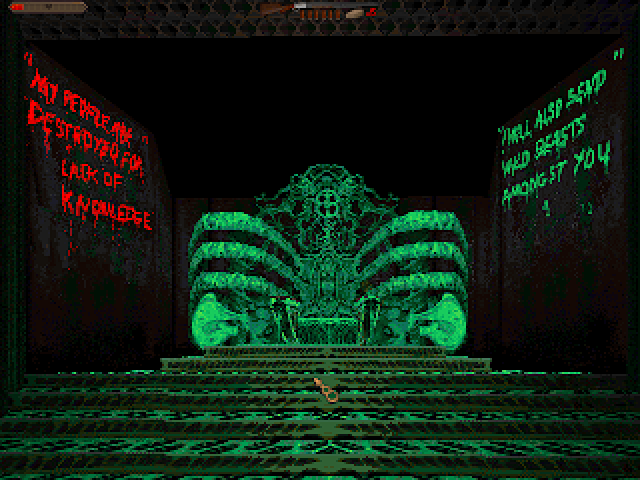<br><sub>Further down, the writing on the walls.</sub></td>
</tr>
</table>

<br>

## 

The hands are the owner's own `hand_final.fbx`, read by the engine itself with [ufbx](https://github.com/ufbx/ufbx): two hands, each with its own skeleton, skin, normal and roughness maps. Every pose is an authored frame of that hand's own animation, and every in-between blends two of them.

<p align="center">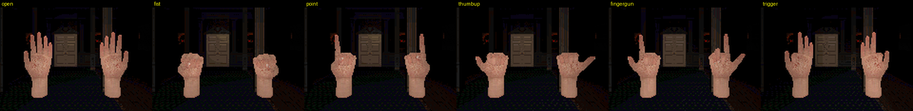</p>

| Index on the trigger | Thumb touching | Pose |
|:-:|:-:|---|
| yes | yes | fist |
| yes | no | thumb up |
| no | yes | point |
| no | no | finger gun |

In VR **your hands are the only way to use the world**. The use key is off; the flat game keeps the original's keys. The **trigger** is the original's examine and the **grip** its use, on what your palm is on or what your straight index points at, at the original's range. A hand holding a weapon fires on its trigger.

<p align="center">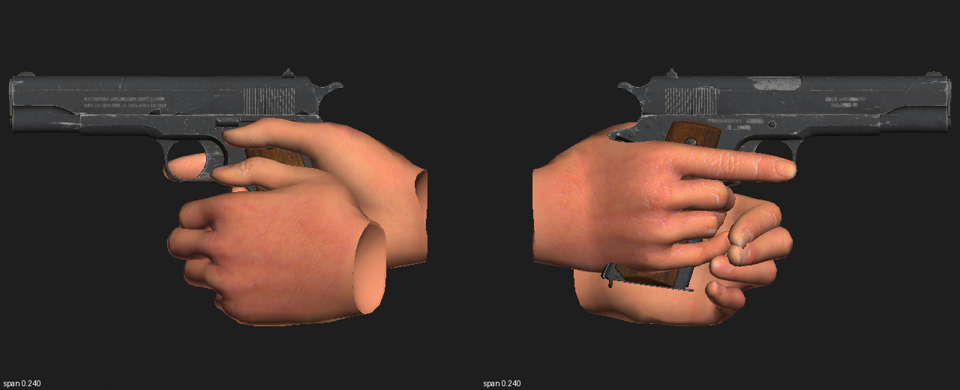</p>
<p align="center"><sub>Two hands on the Colt. The support hand is fitted to the gun and to the shooting hand: it latches within 6 cm and 50° with its grip closed and lets go on any reload action. A software render of the engine's pose maths (<code>tools/colt_test/support_fit</code>).</sub></p>

<br>

## 

<table>
<tr>
<td width="50%">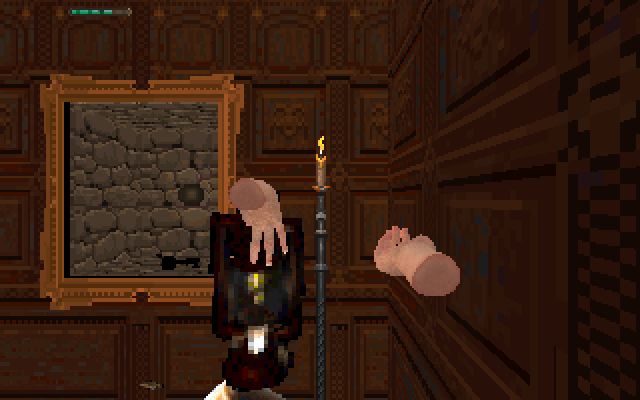<br><sub><b>The Lamp</b> hangs on your hip. Take it and hold it up: the light comes from the lamp in your hand.</sub></td>
<td width="50%">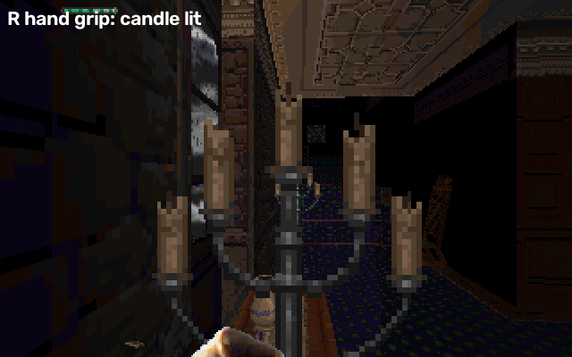<br><sub><b>Strike a match</b> and light the candles wick by wick, in any order. Each holder's light grows as its wicks catch.</sub></td>
</tr>
<tr>
<td>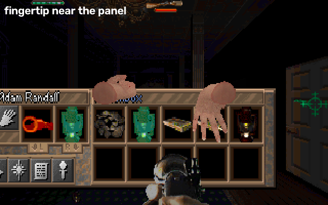<br><sub><b>The inventory by hand.</b> The original's own panel, drawn by its own code. Reach in with a fingertip and take what you need.</sub></td>
<td>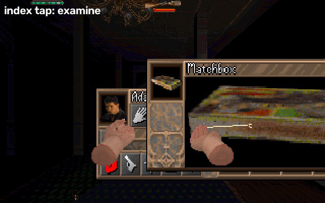<br><sub><b>Tap to examine.</b> The original's examine card opens for the matchbox, pixel for pixel the original's.</sub></td>
</tr>
<tr>
<td>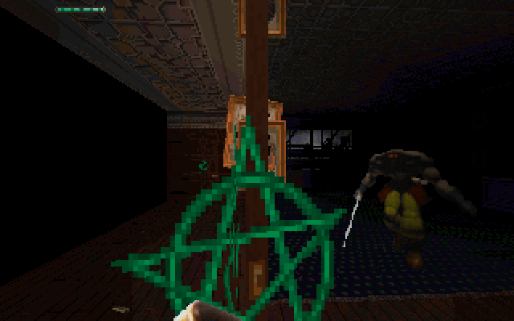<br><sub><b>Wards.</b> Bring a hand near a ward and it tingles, harder the closer you get.</sub></td>
<td>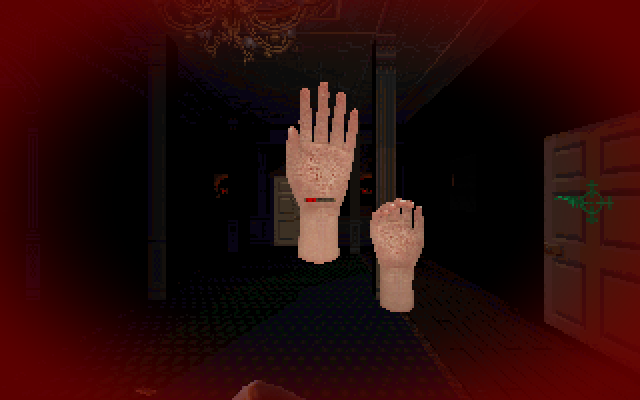<br><sub><b>The off wrist</b> carries the subtitles and your health. When you're nearly dead, the edges of your view bleed red.</sub></td>
</tr>
</table>

<sub>All frames are from the engine on the owner's PC, flat, with the test rig driving the controllers. They show the systems working. Feel, weight and reach are judged in the headset.</sub>

More by hand, each built and run flat: doors swung by their handles, levers pulled on their hinges and keys turned in locks; the Book opened in two hands; statuettes and the Orb set in their places; the clock's hour hand turned; a vial drunk. The Sword is swung, the Staff shot and swung, the Shield worn on the forearm and the Shotgun held in two hands, with six holsters on your body. Things you drop fall and stay where they land, and things you throw fly.

<br>

## 

**The original underneath** is proven against the running original by differential tests (`CLAUDE.md` lists the suites). The movement matches it over 9,686 tics with 0 differing, and the inventory, menus, save and load, dialogue and HUD are drawn by the original's own routines, with 0 pixels differing. All 44 retail maps load, and every instruction the maps use is dispatched. Whether each one does exactly what the original's does is answered suite by suite. What is not ported yet is listed, with evidence, in [`docs/PORT_GAPS.md`](docs/PORT_GAPS.md). The largest open items are the automap, the sliding sectors (behind `roth_platforms`, off by default) and the original's save-file writing.

**The VR game** follows [`docs/VR_GAME_PLAN.md`](docs/VR_GAME_PLAN.md), one slice first: chapters 1 and 2 (the house, the Study, the cellars, the mausoleum, Aelf). Between them they hold almost every kind of thing the game ever asks of you.

| Milestone | State |
|---|---|
| **M1** Solid hands, drop, throw | Built, run flat |
| **M2** Doors, levers and keys by hand | Built, run flat (`track_test` 59/0, `worldhands_test` 87/0, `physics_test` 24/0) |
| **M3** The first headset pass, one owner per hand | **Next.** Almost nothing has been played in the headset yet, and that is the biggest risk, so it comes first |
| **M4** Combat you feel | Planned. The Shield blocks shots; thrown things stun and can hurt |
| **M5** The adventure by hand, all of chapters 1 and 2 | Planned |
| **M6** A physical world | Planned |
| **M7** The slice's look | Planned, with the owner's green light |
| **M8+** Chapters 3 to 20 | Planned |

<br>

## 

```
doomxr.exe -iwad vrealms.pk3 -rothpath "<path to your ROTH folder>" +map STUDY1
```

Quote the path: it has spaces in it. The IWAD must be **`vrealms.pk3`**. It supplies the palette, an episode and a skill, and without them the engine stops before the video backend is up and exits without a word.

Every load writes a report beside the executable: what was opened, what was in it, and a count of anything the loader didn't understand. Nothing fails silently.

<br>

## 

| Start here | |
|---|---|
| [`docs/VR_GAME_PLAN.md`](docs/VR_GAME_PLAN.md) | **The plan.** Every session picks its work from it |
| `LANE_START.md` | Which document holds what, and which parts of each are out of date |
| `docs/REMAROTH_MEASURED.md` | Everything checked against the running original, with numbers. When it and another document disagree, this one wins |
| `docs/PORT_GAPS.md`, `docs/PORT_AUDIT.md` | What of ROTH.C is not ported, and every ROTH.C function against the port |
| `docs/VR_CHANGES_LEDGER.md` | Every VR change, its owner decision and its evidence |
| `docs/VR_PHYSICS.md`, `docs/VR_HANDWORKS.md`, `docs/VR_INTERACTION.md` | Physics, doors and levers by hand, and who owns a grab |
| `docs/FBX_LOADER.md` | The hands: the loader and the poses |
| `ROTH_STATE.md`, `ROTH_LIGHTING.md`, `ROTH_COMMANDS.md` | The file formats, the lighting model and the level-logic system, decoded |
| `ROTH_BETTER.md` | Ideas for later: things the 1996 engine does better than the one hosting it |
| `README_ENGINE.md` | The host fork and its lineage: GZDoom → Team Beef → Emawind's QuestZDoom → iAmErmac's DoomXR → UZDXREMA |

Third-party code, unmodified: `wadsrc/static/zscript/fishy/` is [3D Platform](https://github.com/FishyClock/3Dplatform) by FishyClock (GPL-3.0), the base for `roth_platforms`. Before designing a VR system of its own, the project looks for a proven open-source one to port: Jolt Physics (in the repo), Godot XR Tools, VRExpansionPlugin and UltimateXR, all MIT.

**The rule throughout: the original is the specification.** Where it and the host engine disagree, the original wins and the engine changes. Anything not read out of the original's own code is marked unverified.

<p align="center"></p>

<p align="center"><sub>A fan project. Realms of the Haunting belongs to its rights holders; the cover and the two 1996 screenshots are shown for reference. No game data is included or distributed: you play it from your own install.</sub></p>
